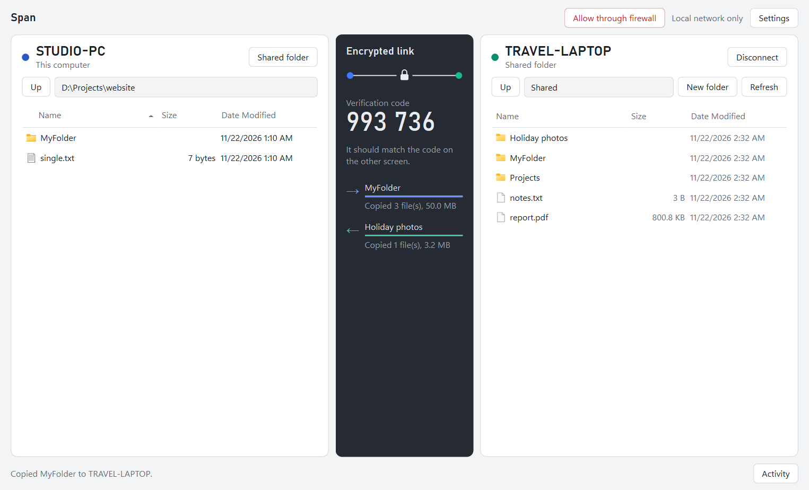

# Span


Copy files and folders between Windows, macOS and Linux computers, encrypted.



Your folders are on the left, the other computer's shared folder is on the right, and you drag items across in either direction.
It works on your local network out of the box. If you add your own relay server, it also works between different locations.

- **Two-pane window**: browse this computer on the left and the other computer's shared folder on the right.
  Drag from left to right to send, and from right to left to download. You can also drop files from Explorer, Finder or your Linux file manager straight onto the right pane.
- **Shares one folder only**: each computer chooses one folder to share (by default `Downloads/Span`).
  Another computer can open it only after you click **Allow**, and it can't see anything outside that folder.
- **Finds other computers automatically**: any computer running the app on your network shows up in the list by name.
- **End-to-end encrypted**: each connection uses a fresh X25519 key exchange and AES-256-GCM.
  Nobody in between can read the files or file names, not even a relay server.
- **Verification code**: both screens show the same 6-digit code. If the codes match, nobody is intercepting the connection.
- **Detects tampering**: if any data is changed or corrupted along the way, the transfer is rejected and the partial file is deleted.
- **Sets up the firewall for you**: on first run the app offers to allow itself through the firewall. You just approve the admin prompt.
- **Optional relay**: off by default. Turn it on to reach computers in other places.
- **Has a window and a command line**: the command line suits servers and SSH sessions.

## Requirements

- Python 3.8 or newer on each computer.
  - **Windows** and **macOS**: install it from [python.org](https://www.python.org/downloads/).
  - **Linux**: usually already installed.
- Two free packages: `cryptography` (encryption) and `PySide6` (the window, about 70 MB).
  **The app offers to install them the first time you open it.** To install them yourself:
  `python -m pip install cryptography PySide6`.
  On Linux distributions that block pip, use your package manager (for example `sudo apt install python3-cryptography python3-pyside6.qtwidgets`) or a virtual environment.
  On a Mac with Homebrew's Python, which also blocks pip, create a virtual environment once.
  `run.command` and `run.sh` use it automatically:
  `python3 -m venv ~/.span-venv && ~/.span-venv/bin/pip install cryptography PySide6`
- If PySide6 can't be installed, the app falls back to a simpler window (`python span.py gui --classic`). That window needs `python3-tk` on Linux.

## Usage

Start the app on **both** computers:

| Windows | macOS | Linux |
|---|---|---|
| double-click `run.bat` (or `python span.py`) | double-click `run.command` (or `python3 span.py`) | `./run.sh` (or `python3 span.py`) |

The first time it starts, the app asks to allow itself through the firewall. Click **Yes**, then approve the administrator prompt.

**On a Mac, the first time:**
- **Opening `run.command`:** macOS blocks downloaded scripts, so right-click it and choose **Open**.
- **Local Network access:** macOS 15 and later also asks whether Span (or Terminal, if you started it there) may find devices on your local network. Click **Allow**.
  Without it, Span can't see or reach other computers. You can change it later in System Settings > Privacy & Security > Local Network.

To copy files:

1. On the right, double-click the other computer, or type its IP address and click **Open**.
2. The other computer is asked whether to let you open its shared folder. The middle of your window and their prompt both show a verification code.
   They should click **Allow** only if the codes match.
3. Drag files or folders across. Drop them on a folder to put them inside it.
   - Left to right sends them to the other computer.
   - Right to left downloads them to the folder you have open on the left.
   - Double-clicking a file on the right downloads it to your current folder.

Transfers appear in the middle with progress and a cancel button.
When someone has your shared folder open, the middle shows their name with a **Disconnect** button.
**Settings** has your computer name, which folder you share, and the relay options.
**Shared folder** (top left) shows you what other computers can see.

### Command line

```
python span.py receive                 # wait for files, asks y/n for each transfer
python span.py receive -y -d ~/inbox   # auto-accept, save into ~/inbox
python span.py list                    # show computers running the app
python span.py send DESKTOP-ABC report.pdf photos/
python span.py send 192.168.1.20 movie.mkv
python span.py firewall                # allow the app through the firewall
python span.py gui --classic           # the simple single-window app
```

Files sent from the command line land in the receiver's shared folder.

## Firewall

The app uses **UDP 50505** to find computers and **TCP 50506** to transfer files.
When it starts, it checks whether the firewall allows these ports. If not, it offers to add the rules and asks for admin permission:

- **Windows**: the app adds two Windows Firewall rules named "Span". They allow these ports only from your local subnet and from Tailscale addresses (100.64.0.0/10).
  The rules apply on every network type, because Windows often marks home Wi-Fi as "Public".
  To remove them: `netsh advfirewall firewall delete rule name="Span (TCP)"` (and the same with `(UDP)`).
- **macOS**: the macOS firewall works per app rather than per port. If it's turned on, Span asks for your administrator password once and adds itself to the allowed apps.
  If the firewall is off, which is the macOS default, nothing needs to change.
- **Linux**: if `ufw` or `firewalld` is active, the app opens the ports using `pkexec` (a graphical password prompt), or `sudo` from the command line.
  If neither is active, nothing needs to change.

If you clicked "No", use **Allow through firewall** at the top of the window, or run `python span.py firewall`.

If computers don't see each other but typing an IP address works, only discovery is blocked.
That's common on guest Wi-Fi and some routers ("AP/client isolation").

## Relay server (optional, for computers in different places)

By default the app works **only on your local network**. If you have a server that both computers can reach,
such as a cheap VPS, you can run a relay on it. Then:

- Computers on the same network still connect **directly**, which is fastest.
- Computers somewhere else appear in the list as **"Through your relay server"**.
- If the relay is down or not set up, everything still works locally.
- The relay only forwards encrypted bytes. It never has the keys, so it can't read files or file names.
  The verification code protects you even from a relay that tries to intercept.
- The laptops only make outgoing connections to the relay, so they need no port forwarding.

**On the server:** copy `span.py` there. The relay needs only Python, not the extra packages.

```
python3 span.py relay --password CHOOSE-A-LONG-PASSWORD      # listens on TCP 50507
sudo ufw allow 50507/tcp                                       # if ufw is on
```

To keep it running after you log out, use a systemd service (`/etc/systemd/system/span-relay.service`):

```ini
[Unit]
Description=Span relay
After=network-online.target

[Service]
ExecStart=/usr/bin/python3 /opt/span/span.py relay
Environment=SPAN_RELAY_PASSWORD=CHOOSE-A-LONG-PASSWORD
DynamicUser=yes
Restart=always

[Install]
WantedBy=multi-user.target
```

Then run `sudo systemctl enable --now span-relay`.

**On each computer:** open **Settings**, tick **Use a relay server**, and enter `your-server.com:50507` and the password.
From the command line, add `--relay your-server.com:50507 --relay-password ...` to `receive`, `send` or `list`.
Once you've saved relay settings in the window, the command line uses them too. Add `--no-relay` to skip them.

The relay password only controls who can *use* your relay. It's sent unencrypted to the relay and stored in `~/.span.json`.
It doesn't protect your files; the end-to-end encryption does that. Use a password you don't use anywhere else.

> **No server?** If both computers run [Tailscale](https://tailscale.com), you don't need a relay.
> Type the other computer's Tailscale IP (100.x.x.x) on the right and click **Open**. The firewall rule already allows Tailscale addresses.

## Make a standalone .exe / binary (optional)

```
pip install pyinstaller cryptography PySide6
# Windows
pyinstaller --onefile --windowed --name Span --icon assets/icon.ico --add-data "assets;assets" span.py
# macOS (creates Span.app)
pyinstaller --windowed --name Span --icon assets/icon.icns --add-data "assets:assets" span.py
# Linux
pyinstaller --onefile --windowed --name span --add-data "assets:assets" span.py
```

The result is in `dist/`. Build on each OS you want a binary for.
The Mac app isn't signed, so the first time, right-click `Span.app` and choose **Open**.

### Linux menu entry (optional)

Save this as `~/.local/share/applications/span.desktop`, changing the paths to where you put the app:

```ini
[Desktop Entry]
Type=Application
Name=Span
Exec=python3 /opt/span/span.py
Icon=/opt/span/assets/icon.png
Categories=Network;FileTransfer;
```

### App icon

The icon is drawn in code by `tools/make_icon.py`: a file crossing between a blue and a green pane, the same colours the window uses for "this computer" and "the other computer".
Run `python tools/make_icon.py` to regenerate the files in `assets/`: `icon.ico` for Windows, `icon.icns` for macOS, and PNGs for Linux.

## Security details

- **Key exchange**: a fresh X25519 key pair for every connection, with a hash commitment. That way a man-in-the-middle can't search for keys that produce matching verification codes.
  HKDF-SHA256 derives one key per direction, the 6-digit code, and a per-connection binding value.
- **Encryption**: every chunk (1 MB) is encrypted and authenticated with AES-256-GCM using a counter nonce. Modified, replayed, reordered or truncated data is rejected.
- **Shared folder access**: a computer you allow gets a session key, delivered over the code-verified connection.
  Every later connection proves it holds that key with an HMAC tied to that specific connection, so the key is never sent again and a man-in-the-middle can't reuse it.
  Paths are checked so nothing outside the shared folder can be listed, read or written, including through symlinks.
  Disconnecting someone, or closing the app, ends their access.
- **What's not hidden**: discovery broadcasts on the local network include the computer's name.
  If you turn on "Accept files sent to me without asking", you also skip the verification code check for sends from the command line, so leave it off on networks you don't trust.
